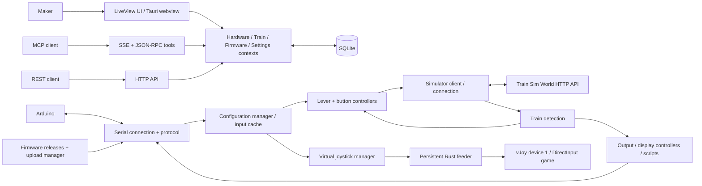

# Feature connections and runtime architecture

This reference describes the current Elixir/Phoenix application at `188f35e4108733358730e92ebd98f1912af5173a`, reviewed 2026-10-25. It is a behavioral specification for understanding/reimplementation, not a design for the existing rewrite branch. [Feature index](README.md) · [persistent data](data-model.md) · [integration test scenarios](rewrite-contract.md).

## Product model and independent operating paths

Trenino lets a maker configure Arduino inputs, buttons/matrices, outputs and HT16K33 displays, then associate those resources with simulator-specific train profiles. Hardware configuration is reusable across trains. A second destination exposes inputs as a Windows virtual joystick independently of the simulator. The same local service serves a browser, Tauri window, REST clients, and MCP automation; business logic resides behind all four interfaces.

Some arrows summarize multi-step calls rather than implying all data travels through one process. In particular controllers also access contexts/Repo; scripts use their own host adapters; display/output subscriptions have distinct lifecycles. See the matrix and flows below.

## Runtime ownership and supervision

`Trenino.Application` starts a one-for-one supervisor. In source order: telemetry, Repo, Ecto.Migrator, firmware DeviceRegistry, DNSCluster, PubSub, general Registry, MCP SessionRegistry, Task.Supervisor, Serial.Connection, Hardware.ConfigurationManager, optional VirtualJoystick.Manager, hardware calibration dynamic supervisor, Firmware.UploadManager, Train.Detection, train calibration dynamic supervisor, endpoint; then optional simulator connection, lever/button/output/display controllers, ScriptRunner, firmware checker, app-version checker.

Each optional worker uses an application-config `start_*` switch, default true. Test config disables simulator/controller/script/checker/joystick workers to isolate external state; serial connection is terminated in test_helper before private hardware guards are installed. Endpoint startup therefore does not imply every optional worker has started or connected; health verifies one database query rather than all runtime dependencies. A one-for-one restart rebuilds only the failed child's memory, not every downstream controller.

The general Registry supports named train-calibration sessions; MCP uses its own session registry. Hardware calibration sessions are unnamed GenServers under their dynamic supervisor, while input-detection sessions are separate unlinked processes monitoring their callback owner. Task.Supervisor owns asynchronous operations such as joystick configuration; other features also use direct Task calls. Firmware DeviceRegistry stores manifest-driven device definitions in ETS. Transient state is not a substitute for SQLite persistence.

Evidence: [application tree](https://github.com/albertorestifo/trenino/blob/188f35e4108733358730e92ebd98f1912af5173a/lib/trenino/application.ex), [runtime config](https://github.com/albertorestifo/trenino/blob/188f35e4108733358730e92ebd98f1912af5173a/config/runtime.exs), [test config](https://github.com/albertorestifo/trenino/blob/188f35e4108733358730e92ebd98f1912af5173a/config/test.exs), [test bootstrap](https://github.com/albertorestifo/trenino/blob/188f35e4108733358730e92ebd98f1912af5173a/test/test_helper.exs).

## Feature dependency matrix

| Feature | Required durable data | Required live services | Produces/feeds |
|---|---|---|---|
| Create hardware configuration | devices, inputs/matrices/outputs/modules | Repo and UI/context operations | Persistent reusable resource IDs; no board connection needed for all edits |
| Apply hardware configuration | saved config_id and components | Serial.Connection, ConfigurationManager, connected board | Configure wire packet, ack/error; later raw input stream |
| Calibrate hardware lever | input and calibration record | ConfigurationManager per-port stream, session | Raw-direction/rollover normalization used by both destinations |
| Train identification | train_identifiers | Simulator.Connection + Detection polling | train_changed to runtime controllers and UI |
| Analyze simulator lever | train element/endpoints | simulator client/control analyzer | simulator notch ranges/types, then hardware-notch mapping |
| Drive simulator lever | enabled lever binding, calibration, notch ranges | active train, connected board, simulator client | PATCH InputValue; latest-value coalescing/retry; unready inputs skipped |
| Drive simulator button | button binding, optional sequence/keystroke | active train, input stream; simulator or key helper | direct PATCH, repeating action, sequence, OS key event |
| Output LED condition | train_output_binding + hardware output | active train, simulator subscription poll, serial output | digital pin on/off |
| Display live data | train_display_binding + module params | active train, simulator subscription poll, serial display commands | formatted segment bytes |
| Lua automation | enabled script, simulator endpoint triggers | active train, script runner, simulator polling/manual/timer | host API writes, output/display changes, logs |
| Firmware installation | cached release/file metadata + manifest | downloader, avrdude, port ownership manager | flash, progress/history, rediscovery; serial port paused while owned |
| Virtual joystick | application-wide mappings + singleton | Windows driver, feeder, board values; no simulator | fixed DirectInput axes/buttons |
| Error reporting | consent setting | DSN-configured Sentry | eligible error events |
| Native app update | embedded public key/feed | compiled updater, GitHub access, tracked backend process | verified install after backend exit |

Exact enabling/validation rules live in linked feature documents. A saved record is not evidence its runtime controller has loaded it.

## Identity boundaries

| Identifier | Scope and role | Do not substitute |
|---|---|---|
| devices.id | SQLite identity for a saved hardware configuration | OS serial port |
| devices.config_id | persisted board configuration identity, sent in Configure and returned in IdentityResponse | input pin or DB row ID; Heartbeat has no body |
| port | runtime OS serial connection identity | permanent physical board serial number |
| device_inputs.id | durable input resource referenced by bindings | GPIO number alone |
| input.pin | real or virtual matrix pin, meaningful with device/port | globally unique input ID |
| trains.id | profile owner for elements, scripts, sequences, output/display bindings | simulator actor class |
| train_identifiers.identifier | case-sensitive simulator class prefix, several per profile | unique runtime actor instance ID |
| lever_config.id | lever configuration owned by an element | element.id; some legacy helper code confuses these |
| MCP session_id | one SSE connection/server registration | authentication credential |
| upload_id | upload operation correlation/history | firmware version or release DB ID |
| joystick device_index | fixed global 1 | Arduino index or train profile |

Two boards returning the same config_id cannot be treated as uniquely identified independent physical resources by map-based consumers. Names are display labels, not routing keys. Resource ownership and simulator membership differ: one hardware configuration can participate in multiple train profiles, while joystick destination conflict checks look across enabled bindings globally.

## End-to-end flows

### A. Connect, identify, apply, monitor

1. Serial discovery enumerates candidate ports and attempts the binary identity handshake.
2. Runtime connection state records port, firmware version and reported config_id; broadcasts device updates.
3. ConfigurationManager connects per-port messages to saved configuration handling. A maker selects/applies a configuration; serial Configure includes real inputs, matrix definitions and I2C modules. Digital outputs are host-side records and do not add Configure parts; SetOutput writes them directly.
4. A matching stored/error message resolves pending state. Saving locally and applying to the board are distinct operations; a rejected/timed-out apply must not be described as installed.
5. InputValue messages become cached `{pin => raw}` state and `input_value_updated` broadcasts on a per-port hardware topic. Live UI, calibration sessions and enabled runtime destinations consume that stream.

See [hardware lifecycle and calibration](hardware.md), [wire protocol](serial-protocol.md), [firmware port handoff](firmware.md).

### B. Reuse a lever with a different train

1. Hardware calibration describes the physical sensor, independent of game control.
2. Simulator endpoint discovery/control analysis describes the game lever's discrete/continuous/hybrid response and expected InputValue ranges.
3. Hardware-notch mapping associates calibrated physical intervals with those simulator ranges; lever configuration inversion is another distinct direction choice.
4. Detection reads the drivable actor class; prefix matching selects exactly one profile, or none on ambiguity.
5. LeverController loads active train bindings and uses its connected-device input lookup (rebuilt at init/device updates). Physical values normalize, select/interpolate a mapped notch, and write simulator values; samples coalesce to the latest while a per-lever writer is in flight, without general duplicate suppression after completion.
6. A different detected train replaces active bindings while preserving the same saved hardware calibration.

See [simulator connection/detection](simulator.md), [train controls/calibration](train-profiles-and-controls.md). Hardware min/max, normalized notch fraction and simulator InputValue are separate value domains.

### C. Simulator data drives real outputs and displays

1. Active train selects enabled output/display bindings.
2. Controllers create simulator subscriptions and periodically retrieve values.
3. Output conditions compare booleans/numbers and write changed digital state; there is no hysteresis implementation.
4. Displays apply a format string, numeric clamp/alignment/dot policy and segment encoder, then send bytes to the module address.
5. Runtime disabling/train change/disconnect cleanup differs between output and display controllers; display explicitly handles simulator reconnect while output does not subscribe to that connection topic.

See [outputs/displays](train-profiles-and-controls.md), [I2C segment encoding](hardware.md), [script display adapters](scripting-and-sequences.md).

### D. Configuration through UI, HTTP and MCP

1. LiveView forms/wizards use domain contexts and session processes; browser events can start physical detection, analysis or calibration.
2. REST exposes a smaller surface: train reads, script CRUD, hardware output listing, simulator browsing/value reads, health/shutdown.
3. MCP exposes a broader tool registry over SSE and JSON-RPC; detection tools also broadcast a modal request to UI subscribers.
4. Validation differs by entry point. JSON schema advertisement is not universal runtime schema enforcement. Some callers explicitly reload controllers after CRUD; others do not.
5. All surfaces refer to the same persistent IDs and background workers; opening a new browser is not a new independent rig configuration runtime.

See [HTTP/MCP contracts](api-and-mcp.md), [UI actions/wizards](user-interface.md). No account permission model mediates these calls.

### E. Switch to independent joystick mode

1. Choose a saved input and destination; replace conflicting enabled train bindings if explicitly requested.
2. Configuration remains in SQLite even when mode off or game disconnected.
3. Windows manager confirms device descriptor and feeder hello before marking active.
4. Hardware stream maps directly to discovered joystick range/button state. Train detection is irrelevant to this path.
5. Board disconnect centers/releases affected controls; normal app exit resets/releases feeder ownership but preserves device configuration.

See [virtual joystick](virtual-joystick.md), [platform stories](platform-user-stories.md).

## Event bus contracts

These are local process notifications, not persistent queued events or a public network protocol. Exact payloads and handling branches are documented by the producing subsystem.

| Topic | Producer | Consumers and purpose |
|---|---|---|
| device_updates | Serial.Connection | UI navigation/config pages; configuration/controller port routing; firmware notices; joystick manager |
| serial:messages:{port} | Serial.Connection | ConfigurationManager, hardware calibration/protocol consumers |
| hardware:configuration | ConfigurationManager | Apply-progress UI and acknowledgment/error handling |
| hardware:input_values:{port} | ConfigurationManager | Live readings, input detection, notch mapping, train input routing and joystick routing |
| hardware:calibration:{input_id} | hardware calibration Session | wizard progress/results |
| simulator:connection | Simulator.Connection | nav UI, Detection, selected runtime controllers |
| train:detection | Train.Detection | UI and train-specific controller/script activation |
| train:notch_mapping:{lever_config_id} | NotchMappingSession | lever setup wizard |
| firmware:uploads | UploadManager | firmware progress/cancel/result UI |
| firmware:update_notifications | firmware UpdateChecker | nav notice/checking/dismissal |
| app_version:update_notifications | app UpdateChecker | direct/browser distribution update notices |
| virtual_joystick | joystick Manager | joystick page and status consumers |
| mcp:detection | MCP DetectionTools | UI overlay requested/completed lifecycle |

Sessions also send direct messages to owners, and a few events use per-feature helper-generated topics; consult [source index](source-index.md). PubSub order/subscriptions are operational requirements: reading a topic name is not sufficient to make the upstream serial/configuration manager subscribe. Most runtime caches reload through explicit events/casts, not through a generic database change stream.

## Persistence versus runtime state

Persistent: hardware resource definitions and calibration, train identifiers/elements/configs/notches/bindings, sequences/commands, Lua code/triggers, firmware release metadata/history/checks, settings and confirmed joystick configuration/mappings.

Transient: serial connection status/port ownership, latest raw input values, simulator clients/health/subscriptions, active train/grace timer, controller caches/pending writers/held keys/repeat tasks, Lua VM state/tasks/timers, wizard sessions, MCP SSE registrations, pending uploads/progress, joystick report/bridge/retries, app-version notices. Heartbeat has a codec but no implemented host liveness timer. A rewrite must decide how each reconstructs from persistent data after failure/restart. Preserving SQLite rows alone does not reproduce all observable lifecycle behavior.

## Scope, external dependencies, and historical material

The reviewed repository contains the desktop/backend, native key/joystick helpers and tests. Arduino firmware is a separately downloaded project; TSW and vJoy are external systems. Their implementations were not included in this review. No additional feature was inferred from the sibling tsw_board workspace. Files under docs/superpowers, docs/plans and .superpowers record historical intent or prior verification; they cannot override current code. Generated icons/capability schemas and vendor CSS are catalogued as assets/generated dependencies, not independent app features. Existing untracked mechanical/rewrite plans were preserved and excluded from the baseline.

The comprehensive [file index](source-index.md) and [coverage records](coverage/baseline.json) make those boundaries explicit. [Rewrite contracts](rewrite-contract.md) identifies which observed behaviors are core acceptance contracts versus current implementation gaps needing a conscious decision.
