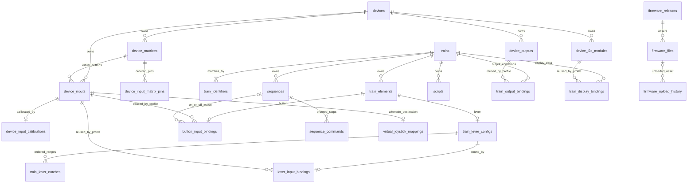

# Persistent data, relationships and migration semantics

Reviewed baseline: `188f35e4108733358730e92ebd98f1912af5173a`, 2026-10-25. This is the final source-defined persistence model, not the historical schema in older guides or an inspection of a user's live data. The [field dictionary](schema-dictionary.md) enumerates current Ecto declarations; feature documents explain meaning and changeset validations. [Architecture](architecture.md) explains runtime caches and identity boundaries.

## Conventions

SQLite through Ecto.Adapters.SQLite3 is the single local database. Most tables have autoincrement integer id plus UTC inserted_at/updated_at; `app_settings` instead uses a string key without timestamps, and joystick configuration is a non-autogenerated singleton ID. Ecto enums normally store strings; booleans use SQLite-compatible storage; scripts/triggers and polymorphic module params are serialized text/JSON. Nullable database columns and required Ecto fields are distinct: migrations did not retrofit every NOT NULL or uniqueness constraint promised by schemas. Reimplementation should validate through domain contracts as well as database constraints.

## Entity graph

Graph cardinalities express intended application relationships. For example calibration is a has_one association, but its original migration only creates an input_id index, not a unique index. At least one train identifier is an application validation, not a SQL minimum-row constraint. `train_display_bindings.script_id` is a nullable SQL FK to scripts, even though the Ecto field is plain integer and runtime display formatting does not execute that script.

## Table ownership, uniqueness and deletion

| Table | Owner and durable purpose | Database uniqueness/deletion semantics |
|---|---|---|
| devices | Saved configuration: name, description, config_id | Unique config_id; original id/name/config columns nullable in DB; context/schema impose stronger rules |
| device_inputs | GPIO/virtual pin, analog/button settings, name | Unique device_id+pin; device FK originally on_delete nothing; matrix FK cascades; context deletes dependent calibration as needed |
| device_input_calibrations | Physical sensor bounds, hardware max, inversion, rollover | Indexed input_id; original FK on_delete nothing; no DB one-per-input unique |
| device_matrices | Named matrix per device | device deletion cascades |
| device_input_matrix_pins | Ordered row/column GPIOs | Unique matrix_id+pin_type+position; matrix deletion cascades |
| device_outputs | Named output GPIO | Unique device_id+pin; device deletion cascades |
| device_i2c_modules | Chip/address and polymorphic params | Unique device_id+i2c_address; device deletion cascades |
| trains | Profile name/description | Identifier moved to separate table; deletion cascades into dependent tables through their FKs |
| train_identifiers | Multiple class-prefix aliases per train | Global unique identifier; train deletion cascades |
| train_elements | Name/type lever or button | train deletion cascades; no global name uniqueness constraint |
| train_lever_configs | Endpoints/type/inversion/calibrated_at | Unique element_id; element deletion cascades |
| train_lever_notches | Gate/linear output values and hardware/simulator ranges | Unique lever_config_id+index; lever deletion cascades |
| lever_input_bindings | Input linked to lever config; enabled | Unique lever_config_id; both FKs cascade; input reused across different configs unless conflicting joystick destination |
| button_input_bindings | Button element/input/action mode; direct/sequence/key data | Unique element_id; input/element cascade; sequence refs SET NULL |
| sequences | Train-scoped named macros | Unique train_id+name; train cascade |
| sequence_commands | Position/endpoint/value/delay_ms | Unique sequence_id+position; sequence cascade |
| train_output_bindings | LED condition linking simulator endpoint to output | Unique train_id+output_id; train/output cascade; value_a nullable for boolean operators |
| scripts | Named enabled Lua source + serialized triggers | Unique train_id+name; train cascade |
| train_display_bindings | Module/endpoint/format/enabled/name, optional script_id | Unique train_id+i2c_module_id; train/module cascade; script deletion SET NULL |
| firmware_releases | Cached version/tag/URLs/notes/time/manifest JSON | Unique tag_name; metadata not firmware binary content |
| firmware_files | Release board/environment/download URL/size/checksum | Unique firmware_release_id+board_type; release cascade; environment indexed |
| firmware_upload_history | upload_id/port/board/status/error/log/duration/times | firmware_file deletion SET NULL; indexes status/started_at; no migration unique upload_id |
| firmware_update_checks | checked_at/found_updates/version/error | checked_at indexed; separate from app-version in-memory checker |
| app_settings | String key/value preferences | key primary key; value NOT NULL; upsert by key |
| virtual_joystick_configurations | Last confirmed enabled, fixed index 1 | CHECK id=1 and device_index=1 |
| virtual_joystick_mappings | Input to axis or button; inversion | Unique input; partial unique device+axis and device+button; FK input cascade; CHECK target shape/enum/range/index |

The actual operation order matters where old FKs do not cascade. Treat database-level deletion rules and context helpers as separate layers; use the behavior described in [hardware](hardware.md) and [train controls](train-profiles-and-controls.md), rather than assuming every parent deletion is a bare SQL delete.

## Value domains and identity rules

- Sensor readings and raw calibration endpoints are integers; calibrated hardware travel is an integer distance, then callers may divide by total travel to obtain a fraction.
- A notch has two coordinate systems: hardware `input_min/input_max` fraction and simulator `sim_input_min/sim_input_max` command interval. Its displayed/output `value/min_value/max_value` is another set of simulator observations. They are not interchangeable.
- Persisted simulator/control/calibration floats are generally rounded to two decimals by application paths, but not every external payload guarantees that precision; read the specific caller contract.
- Button/matrix virtual pins share the input.pin namespace; legacy `button_input_bindings.virtual_pin` no longer exists.
- Device config_id is persisted in board identity; OS port is runtime location. No current devices table field stores an OS port as permanent identity.
- Train aliases trim whitespace and compare prefixes case-sensitively; exact alias uniqueness does not prevent overlapping different prefixes from matching the same actor.
- Exclusive joystick-versus-enabled-simulator destinations are enforced transactionally by contexts, not by a cross-table SQL constraint. Disabled simulator bindings may coexist with a joystick mapping.

## Migration history that changes interpretation

All 41 timestamped migration files are in the [source index](source-index.md). Particularly relevant transformations:

| Migration | Effect and rewrite/import implication |
|---|---|
| 20251128125215 + 20251129112341 | Add unique config_id and populate missing values using random positive i32 with collision retry; rollback does not remove generated IDs |
| 20251210215004 | Remove firmware file_path/downloaded_at columns; cache paths now derive from release.version plus environment (or board_type fallback), rather than download-state rows |
| 20251221173532 | Historical matrix inputs could have null pin with partial uniqueness; superseded by matrix refactor |
| 20251223112836 | Rebuild button bindings to make endpoint nullable for sequences; copies known fields and recreates selected indexes |
| 20251223210242 | Separate matrices; create virtual button input rows for previously bound virtual pins; transfer bindings; rebuild matrix pins/button table; remove virtual_pin; restore unique device+pin; irreversible |
| 20260101201704 | Copy existing input ranges into simulator ranges; later hardware mapping owns input_min/max |
| 20260103194112 | Add keystroke text; enum/mode behavior remains application-level |
| 20260106154322 | Delete old nano_old_bootloader firmware asset metadata; no undo data restoration |
| 20260107220815 | Rebuild output binding table with nullable value_a for boolean comparisons |
| 20260117101411 | Add manifest JSON/environment; map legacy board_type strings to PlatformIO environments; board_type column remains |
| 20260201154004 | Add scripts with JSON-text trigger field and per-train name uniqueness |
| 20260503000000 | Remove any old BLDC columns/index, clear bldc lever type; explicitly irreversible; BLDC is not a supported current feature |
| 20260503114723 | Migrate manually supplied simulator config rows into settings; skip auto_detected rows; drop simulator_configs; down recreates empty old table without recovering settings |
| 20260503200000 + 20260503220000 | Create I2C modules, then replace top-level brightness/digits with params JSON; populate brightness=8/digits=4 when null plus fourteen_segment/no-dot/right alignment/min=0 defaults |
| 20260503200001 | Add display bindings, script FK nullable and SET NULL |
| 20260801000000 | Fixed joystick singleton and constrained destination table |
| 20260927000000 | Validate legacy nonblank and trimmed-unique identifiers, create child alias rows, trim/copy, remove trains.identifier; irreversible to avoid inventing a primary alias |

The matrix migration derives matrix pin association by matching device_id and taking a first match; old multiple-matrix data can be ambiguous. It creates virtual button rows from existing bindings rather than every possible old matrix cell. Its stated plan to make pin NOT NULL is explicitly skipped at the DB layer. Importing legacy data requires knowing which migration stage produced it.

The identifier migration validates before destructive changes and deliberately raises on whitespace collisions. Multiple identifier support therefore is not a comma-separated field or a lossy overwrite. See [migration test](https://github.com/albertorestifo/trenino/blob/188f35e4108733358730e92ebd98f1912af5173a/test/trenino/repo/migrations/create_train_identifiers_test.exs).

## JSON and transient serialization

Module params use `polymorphic_embeds_one` with HT16K33 identifying fields and embedded schema defaults. The database column is text; the current schema can raise if an embed type cannot be identified. Script triggers use `Trenino.Train.Script.TriggersType`, storing a JSON list of simulator endpoint strings. UI/MCP/REST present related shapes differently; [API/MCP](api-and-mcp.md) and [scripting](scripting-and-sequences.md) give the public forms. Firmware release manifests are JSON strings in metadata and rehydrate a dynamic device registry; they do not add new SQL columns per board type.

Registry references, OS process handles, timers, raw value caches, Lua VMs, outstanding request IDs, active train choice and upload-in-progress tasks are not persisted in these tables. Upload audit history survives; resuming the task itself after restart is not implied.

## Test isolation and evidence limits

`test_helper` builds a migrated SQLite template. Async DataCase tests copy it into unique databases and set a dynamic Repo; synchronous tests use SQL sandbox, and spawned workers require the appropriate ownership arrangement. ConnCase defaults consent to disabled unless a test requests unset consent. Forbidden UART/discovery/avrdude adapters reject unexpected hardware access; joystick tests inject fakes. Migration-module isolation purges loaded migration modules before loading a copied set to avoid redefinition warnings.

These mechanisms make many unit contracts observable, but fake-adapter tests do not certify a physical board, Windows driver or running simulator. Some tests reproduce helper logic instead of calling production behavior; feature docs flag such cases. This documentation change validates its links, baseline/coverage and publication scope separately from historical application test results.

Sources: [Repo](https://github.com/albertorestifo/trenino/blob/188f35e4108733358730e92ebd98f1912af5173a/lib/trenino/repo.ex), [test bootstrap](https://github.com/albertorestifo/trenino/blob/188f35e4108733358730e92ebd98f1912af5173a/test/test_helper.exs), [DataCase](https://github.com/albertorestifo/trenino/blob/188f35e4108733358730e92ebd98f1912af5173a/test/support/data_case.ex), [hardware guards](https://github.com/albertorestifo/trenino/blob/188f35e4108733358730e92ebd98f1912af5173a/test/support/forbidden_serial.ex), [migration isolation](https://github.com/albertorestifo/trenino/blob/188f35e4108733358730e92ebd98f1912af5173a/test/support/migration_module_isolation.ex), [migrations directory](https://github.com/albertorestifo/trenino/blob/188f35e4108733358730e92ebd98f1912af5173a/priv/repo/migrations/20260927000000_create_train_identifiers.exs).
