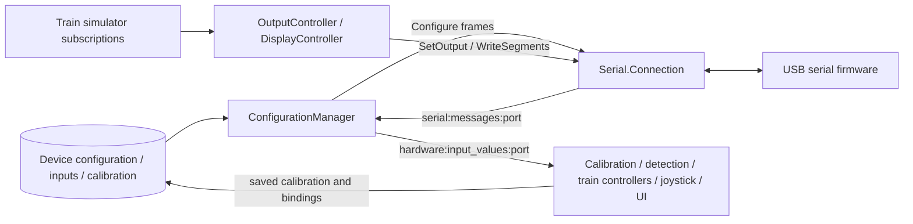

# Hardware configuration, input processing, and displays

Implemented behavior at `188f35e4108733358730e92ebd98f1912af5173a`, reviewed on 2026-10-25. This chapter is based on host source and tests; it does not claim live-device verification. Related contracts: [serial protocol](serial-protocol.md), [firmware installation](firmware.md), [hardware/firmware user stories](hardware-user-stories.md). UI details are documented separately; this chapter supplies the persistent domain and running-process behavior behind them.

## Responsibilities and end-to-end paths

[Trenino.Hardware](https://github.com/albertorestifo/trenino/blob/188f35e4108733358730e92ebd98f1912af5173a/lib/trenino/hardware.ex) is the database context for named device configurations, direct inputs, button matrices, digital outputs, I2C modules, and input calibrations. A database `Device` is a reusable **configuration**, not a USB device record. A physical serial connection is a [DeviceConnection](https://github.com/albertorestifo/trenino/blob/188f35e4108733358730e92ebd98f1912af5173a/lib/trenino/serial/connection/device_connection.ex), identified by current port and reporting a saved config ID/version. The stable association is config_id, not port, database ID, or hardware serial number. Multiple physical devices may report the same config ID; the host does not enforce a one-physical-device-per-configuration rule.

The [application supervisor](https://github.com/albertorestifo/trenino/blob/188f35e4108733358730e92ebd98f1912af5173a/lib/trenino/application.ex) starts Repo, DeviceRegistry, PubSub, registries, task supervisor, Serial.Connection, Hardware.ConfigurationManager, calibration dynamic supervisor, and Firmware.UploadManager. Train controllers and firmware update checking are additional conditionally configured children. Hardware does not call the simulator directly: input events flow to train bindings/controllers and virtual joystick mapping; simulator-derived output/display bindings call back into Hardware and serial.



Normal user sequence is: create a named configuration; add physical analog/button inputs, optional matrix, outputs, displays; scan/connect a physical board; apply configuration and await ACK; calibrate analog inputs; bind controls or joystick destinations; test outputs/displays and observe live values. Direct-input/button names and hardware pin numbers are shared by UI selection, MCP inspection, train bindings, and joystick mapping. Output and I2C bindings depend on an active train elsewhere; raw hardware APIs themselves have no train requirement.

## Persistent entities, fields, and invariants

All schemas use integer database IDs and UTC-second inserted/updated timestamps. Context create/update functions return `{:ok, struct}` or an Ecto changeset error; integer lookups return `{:error, :not_found}` instead of raising. Caller/UI defaults must be distinguished from schema defaults.

| Entity / table | Exposed fields and defaults | Required/validated behavior |
|---|---|---|
| [Device](https://github.com/albertorestifo/trenino/blob/188f35e4108733358730e92ebd98f1912af5173a/lib/trenino/hardware/device.ex), `devices` | name, optional description, config_id; has many inputs/outputs/I2C modules | name required; config_id required and database-unique. If nil, generate before insert/update. Schema does not itself apply ConfigId.valid? to supplied integers. No name uniqueness/max-length validation. |
| [Input](https://github.com/albertorestifo/trenino/blob/188f35e4108733358730e92ebd98f1912af5173a/lib/trenino/hardware/input.ex), `device_inputs` | pin, input_type `:analog` or `:button`, sensitivity, debounce, optional name, device_id, optional matrix_id | type/device/pin required; analog requires sensitivity integer >0 and ≤10; button requires debounce 0–255. Physical matrix_id=nil: pin 0–127. matrix_id present: pin 128–255. Unique `(device_id,pin)`; device/matrix foreign-key constraints. No schema default sensitivity/debounce; caller must supply correct field. |
| [Calibration](https://github.com/albertorestifo/trenino/blob/188f35e4108733358730e92ebd98f1912af5173a/lib/trenino/hardware/input/calibration.ex), `device_input_calibrations` | max_hardware_value, min_value, max_value, has_rollover=false, is_inverted=false, input_id | All six required. No changeset check that min/max are ordered, within hardware range, analog-only, or nonzero travel. Stored endpoint values are raw ADC at physical minimum/maximum, not necessarily numerically sorted. |
| [Matrix](https://github.com/albertorestifo/trenino/blob/188f35e4108733358730e92ebd98f1912af5173a/lib/trenino/hardware/matrix.ex), `device_matrices` | name, device_id; ordered row_pins/col_pins and virtual button Input children | name/device required; name length 1–100; device FK. No schema row count/column count/cell-capacity validation. |
| [MatrixPin](https://github.com/albertorestifo/trenino/blob/188f35e4108733358730e92ebd98f1912af5173a/lib/trenino/hardware/input/matrix_pin.ex), `device_input_matrix_pins` | matrix_id, pin_type `:row`/`:col`, pin, zero-based position | All required; physical pin 0–127, position ≥0; unique `(matrix_id,pin_type,position)` and matrix FK. Physical pin values are not globally unique across rows/columns/direct inputs. |
| [Output](https://github.com/albertorestifo/trenino/blob/188f35e4108733358730e92ebd98f1912af5173a/lib/trenino/hardware/output.ex), `device_outputs` | pin, optional name, device_id | pin/device required; pin 0–255; name ≤100; unique `(device_id,pin)`. Output/input pin collisions are not checked across their separate tables. |
| [I2cModule](https://github.com/albertorestifo/trenino/blob/188f35e4108733358730e92ebd98f1912af5173a/lib/trenino/hardware/i2c_module.ex), `device_i2c_modules` | optional name, module_chip `:ht16k33`, i2c_address, device_id, polymorphic params embed | device/chip/address/params required; address integer 0–255; name ≤100; unique `(device_id,i2c_address)`; device FK. Actual conventional I2C/HT16K33 address ranges are not imposed. |
| [HT16K33.Params](https://github.com/albertorestifo/trenino/blob/188f35e4108733358730e92ebd98f1912af5173a/lib/trenino/hardware/ht16k33/params.ex), JSON embed | brightness=8, num_digits=4, display_type=`:fourteen_segment`, has_dot=false, align_right=true, min_value=0.0 | brightness 0–15; num_digits exactly 4 or 8; display_type `:seven_segment`/`:fourteen_segment`; first five fields required; min_value nullable float without range validation. |

Config ID utility [ConfigId](https://github.com/albertorestifo/trenino/blob/188f35e4108733358730e92ebd98f1912af5173a/lib/trenino/hardware/config_id.ex) generates uniformly using `:rand.uniform` in 1…2,147,483,647 and recursively retries if Repo finds an existing Device. `valid?/1` accepts only integers in that range. `parse/1` requires a binary containing a complete decimal integer with no suffix and the same bounds; invalid/nonbinary returns `{:error, :invalid}`. The generator's uniqueness query is not an atomic reservation; database unique constraint is the final collision safeguard. Config ID 0 is a valid protocol value for unconfigured physical firmware but not a normal generated application ID.

I2C address parsing accepts decimal strings or lowercase `0x` prefix followed by complete hexadecimal digits in 0…255. Uppercase prefix `0X70`, negative values, suffixes, nonnumeric values, and >255 reject with `:error`. Formatting is decimal followed by uppercase hexadecimal padded to at least two digits, e.g. `112 (0x70)` and `255 (0xFF)`. Evidence: [I2C module tests](https://github.com/albertorestifo/trenino/blob/188f35e4108733358730e92ebd98f1912af5173a/test/trenino/hardware/i2c_module_test.exs).

## Context operations and selection semantics

[Hardware](https://github.com/albertorestifo/trenino/blob/188f35e4108733358730e92ebd98f1912af5173a/lib/trenino/hardware.ex) exposes the following query/mutation families. Their ordering/filtering affects rewrite selectors and compatibility.

| Operations | Behavior |
|---|---|
| list_configurations(opts) | Returns all Devices sorted by name; optional `preload`, default none. |
| get_device(id, opts), get_device_by_config_id(config_id) | ID lookup preloads only requested associations; config-ID lookup always preloads inputs. |
| create_device, update_device, confirm_configuration | Shared Device changeset; confirmation re-fetches by database ID then writes config_id. Updating names/descriptions/pins does not itself push changes to firmware. |
| list_inputs(device_id, opts) | Returns `{:ok, inputs}` sorted by pin, preloads calibration; hides matrix virtual buttons unless `include_virtual_buttons: true`. |
| list_all_inputs(opts) | Returns a bare list joined to Device, sorted device name then pin, preloads device/calibration. By default inner-joins calibration and hides virtual buttons. `include_uncalibrated: true` and `include_virtual_buttons: true` independently remove these filters. A button without calibration is excluded unless caller opts in. |
| get_input(id, opts), create_input(device_id, attrs), update_input(input, attrs), delete_input(id or struct) | CRUD using Input changeset, optional get preloads; missing integer delete gives not_found. Deleting an input directly uses Repo.delete; calibration/binding cascades rely on DB relations. |
| list_matrices(device_id), get_matrix(id, opts) | List sorted by name and preloads row/column pins/buttons; get preloads these three by default, overridable. |
| list_outputs(device_id), get_output(id), create/update/delete_output | Lists as `{:ok, outputs}` sorted by pin; get preloads device; delete accepts ID/struct. Output metadata does not participate in Configure. |
| list_i2c_modules(device_id), list_all_i2c_modules, get_i2c_module | Lists are bare lists sorted address; all/get preload device. |
| create/update/delete_i2c_module | Polymorphic changeset; edits stored embed; no implicit resend of whole configuration. |
| save_calibration(input_id, attrs) | Adds atom input_id, inserts if none for input or updates existing. Does not require a calibration Session and has no separate result broadcast. |
| set_output(port,pin,:low/:high), write_segments(port,address,binary) | Build protocol structs and delegate Connection.send_message; raw APIs do not require a matching saved Output/I2cModule record. |

Device deletion checks `Connection.list_devices` and blocks with `:configuration_active` if any `:connected` physical connection reports matching config_id. Other statuses do not block. A nil config_id is considered inactive. Because list_devices returns `[]` on call failure, blocked/unavailable Connection can make the guard permissive. The context manually deletes all inputs including virtual children and each calibration, deletes matrices, then deletes Device; this sequence is not wrapped in a transaction and individual delete results are not propagated before continuing. Outputs/I2C child deletion follows database cascade policy rather than explicit loops here. A rewrite should preserve the intended safety guard and decide explicitly whether to strengthen atomicity.

Evidence: [Hardware context tests](https://github.com/albertorestifo/trenino/blob/188f35e4108733358730e92ebd98f1912af5173a/test/trenino/hardware_test.exs) cover generation, lookups/preloads, name/config-ID updates, deletion including calibrations/matrices, string-keyed input forms, sensitivity bounds, per-device pin uniqueness, matrix creation/update/delete, virtual filtering. [Input tests](https://github.com/albertorestifo/trenino/blob/188f35e4108733358730e92ebd98f1912af5173a/test/trenino/hardware/input_test.exs) cover valid analog/button changesets. [Output tests](https://github.com/albertorestifo/trenino/blob/188f35e4108733358730e92ebd98f1912af5173a/test/trenino/hardware/output_test.exs) cover required fields, 0/255 bounds, >100-character names, duplicate same-device pins, and same pin across different Devices.

## Button matrix creation and destructive resize

`create_matrix(device_id, %{name:, row_pins: [...], col_pins: [...]})` reads atom keys; unlike Input changesets it does not normalize string-keyed row/column lists. It starts a Repo transaction, inserts Matrix with name, inserts ordered physical row/column MatrixPin rows, and inserts one virtual button Input per cell. For row index r, column c, C columns:

`virtual_pin = 128 + r*C + c`

The virtual input uses type button, name `R{r}C{c}` (zero based), debounce 50, parent matrix_id/device_id. Example rows `[2,3]`, columns `[8,9,10]` produce six pins 128…133. All insertions are checked; an error rolls back the transaction. Row/column association preload order is position ascending, and deployment additionally sorts by position.

`update_matrix(matrix, attrs)` transactionally changes name only when key `:name` exists. Pins change only when **both** row_pins and col_pins are nonnil. A one-sided pin update is ignored. When both provided, it bulk-deletes all existing virtual Inputs and MatrixPins and creates replacements even if arrays did not change. Existing virtual button IDs/names/bindings therefore do not survive resizing/reordering; related button bindings are cascade-deleted. Name-only update preserves children. `delete_matrix` accepts ID/struct; database cascades remove pins/buttons/bindings.

Only one useful matrix per device is currently possible: each matrix starts at pin 128, so another collides on device-input uniqueness. This is explicitly noted in [Hardware tests](https://github.com/albertorestifo/trenino/blob/188f35e4108733358730e92ebd98f1912af5173a/test/trenino/hardware_test.exs). Cell counts >128 eventually violate virtual range. Duplicate physical pin use, overlap between row/column pins, and empty dimension lists have no dedicated context validation; Elixir descending `0..(count-1)` ranges for empty dimensions make empty-input behavior unsafe to infer as a clean empty grid. Do not turn those missing checks into supported board capabilities. The serial codec separately permits empty matrix arrays.

## Applying configuration and asynchronous completion

[ConfigurationManager](https://github.com/albertorestifo/trenino/blob/188f35e4108733358730e92ebd98f1912af5173a/lib/trenino/hardware/configuration_manager.ex) is the coordinating GenServer. Public `apply_configuration(port, device_id)` subscribes lazily to that port's serial events, loads Device, physical inputs, matrices, I2C modules, rejects the all-empty case as `:no_inputs`, and sends a series of Configure messages. Display-only and matrix-only configurations are accepted; output-only configurations reject because Outputs are host metadata, not configuration parts.

Part ordering is physical inputs sorted pin, matrices sorted name, I2C modules sorted address. Each matrix occupies one part; virtual buttons do not. Every message uses the Device's **existing config_id**, common total_parts, zero-based part index. No new config ID is generated on apply despite outdated comments saying otherwise. Analog payload takes sensitivity; button takes debounce; matrix has ordered row/col pins; HT16K33 takes address/brightness/digits only. On first send error it stops immediately and returns that error; any previously sent parts remain sent and no in-flight timer is installed for a partial send failure.

After all writes succeed, it starts a 10,000 ms timer and stores `in_flight[config_id] = %{port, timer_ref, device_id}`, returning `{:ok, config_id}` immediately. This return means bytes were handed off, not that firmware stored them. It does not verify a connected device's version/compatibility itself. There is no automatic retransmit or rollback.

| Incoming event | Completion behavior |
|---|---|
| ConfigurationStored for known ID | Pop in-flight entry, cancel timer, persist config ID via Hardware.confirm_configuration, cast Connection.update_device_config_id for **the received event's port**, then broadcast `{:configuration_applied, port, device, config_id}` on `hardware:configuration`. Persistence failure broadcasts `{:configuration_failed, port, device_id, reason}`. |
| ConfigurationError for known ID | Pop/cancel; broadcast failure `:device_rejected`. |
| Timeout for known ID | Pop; broadcast failure `:timeout` using tracked port/device. |
| Any ACK/error/timeout for unknown ID | Ignore. Late ACK after timeout therefore has no success effect. |
| ModuleError | Log address/error_code warning; does not undo ConfigurationStored or expose a dedicated status event. |

Concurrency is serialized by GenServer message handling, but not protected per device/port operation: a second apply with the same config_id overwrites the first entry without canceling its old timer; applies of different configs to the same port can coexist; response correlation is config_id only and does not verify the port matches tracked port. A stale response or stale timer can complete/fail a later apply that reuses the ID. These are source-derived risks, not test-confirmed hardware outcomes.

Evidence: [ConfigurationManager tests](https://github.com/albertorestifo/trenino/blob/188f35e4108733358730e92ebd98f1912af5173a/test/trenino/hardware/configuration_manager_test.exs) cover empty/missing configs, stable IDs, display-only deployment with mocked serial, unknown ACK/error ignoring, value caching, negative values, and subscriptions. Some stable-ID tests only re-fetch Device rather than exercise an actual apply/ACK; source provides the stronger implementation evidence.

## Raw value caching and PubSub integration

`Hardware.subscribe_input_values(port)` casts an ensure-subscription request to ConfigurationManager, then subscribes caller to `hardware:input_values:{port}`. First subscription/apply inserts port into an unbounded `subscribed_ports` MapSet and calls `Connection.subscribe_messages(port)`; there is no corresponding unsubscribe. `get_input_values(port)` returns a map `pin => last_raw_integer`, default `%{}`.

InputValue stores/overwrites exactly the received value, including negatives, then broadcasts `{:input_value_updated, port, pin, value}`. There is no timestamp, normalization, schema-pin lookup, rate limit, deduplication, or stale-value expiry here. Consumers apply their own semantics. On `{:devices_updated, devices}`, cache entries are retained for every port present in the list and removed only for absent ports; despite comments saying connected devices, no status filter exists. Since Connection normally broadcasts **all tracked statuses**, cached values can remain on a failed/disconnecting/uploading port. A manual rescan deleting failed entries can finally remove them. This matters for UI freshness and rewrite disconnect semantics.

The ConfigurationManager provides connected lookup helpers config_id_to_port / port_to_config_id using Connection.connected_devices. The former returns the first match, so duplicate physical config IDs are ambiguous. Related topic and event payloads are specified in [serial protocol](serial-protocol.md#public-calls-broadcasts-and-failures).

## Host input calibration state machine

[Hardware.start_calibration_session](https://github.com/albertorestifo/trenino/blob/188f35e4108733358730e92ebd98f1912af5173a/lib/trenino/hardware.ex) merges options with fixed input_id/port/pin from the selected Input and starts a [Session](https://github.com/albertorestifo/trenino/blob/188f35e4108733358730e92ebd98f1912af5173a/lib/trenino/hardware/calibration/session.ex) under [SessionSupervisor](https://github.com/albertorestifo/trenino/blob/188f35e4108733358730e92ebd98f1912af5173a/lib/trenino/hardware/calibration/session_supervisor.ex), a DynamicSupervisor with one_for_one strategy. The session is a separate GenServer, unnamed and not deduplicated by input. The generated child spec uses GenServer's default restart policy; despite comments calling it temporary, no explicit `restart: :temporary` override exists, so a normal workflow stop under this supervisor can be restarted. This lifecycle needs explicit review in a rewrite.

Options: input_id, port, pin required; max_hardware_value optional, default 1023. It subscribes to input values, initializes `:ready`, and emits `{:session_started, public_state}`. During collecting states, each value for its pin is prepended to the appropriate unbounded sample list; other pins are ignored. The event handler matches pin but does not compare the tuple's port; normal PubSub subscription supplies port isolation. There is no inactivity timeout, caller monitor, disconnection handler, sampling timer, or input-type validation in Session.

| Current step | User advance condition | Next step / effect |
|---|---|---|
| ready | Always | collecting_min |
| collecting_min | ≥10 samples **and ≥3 unique values** | sweeping; otherwise `:insufficient_samples` |
| sweeping | ≥10 samples, no uniqueness requirement | collecting_max; otherwise `:insufficient_sweep_samples` |
| collecting_max | ≥10 samples and ≥3 unique | analyzing; otherwise `:insufficient_samples` |
| analyzing / complete | Never | `:invalid_step` |

Each successful advance emits `{:step_changed, public_state}`. Entering analyzing sends an internal `:analyze_and_save`, reverses lists to chronological order, analyzes sweep, derives endpoints from min/max samples, upserts Calibration, emits `{:calibration_result, {:ok, calibration}}` or `{:calibration_result, {:error, reason}}`, and stops normally with step complete. Collected samples emit `{:sample_collected, public_state}`. Cancel casts a normal stop without result/cancelled event and without saving. A perfectly steady endpoint can fail the three-unique-values rule; the wizard's “hold steady” text should not be interpreted as accepting ten identical samples.

Topic: `hardware:calibration:{input_id}`. Public state keys: input_id, pin, current_step, min_sample_count, min_unique_count, sweep_sample_count, max_sample_count, max_unique_count, can_advance, result. `get_state/1` returns all raw lists/internal state; `get_public_state/1` returns that map. No raw sample value is included in public state.

### Sweep analysis

[Analyzer](https://github.com/albertorestifo/trenino/blob/188f35e4108733358730e92ebd98f1912af5173a/lib/trenino/hardware/calibration/analyzer.ex) returns [Analysis](https://github.com/albertorestifo/trenino/blob/188f35e4108733358730e92ebd98f1912af5173a/lib/trenino/hardware/calibration/analyzer/analysis.ex) `{inverted, rollover}`. Fewer than two samples gives both false. Otherwise adjacent signed deltas are computed. Inverted is true iff their median is <0. Even-length median is integer `div(a+b,2)`, not floating mean. Rollover uses absolute deltas: true iff largest delta is strictly greater than `max(3*median_absolute_delta,10)` **and** strictly greater than `0.8*max_hardware_value`. Thus not every large motion or boundary touch implies wrap, and direction depends on the predominant chronological sweep rather than just endpoints.

Logical minimum raw value uses Enum.min of endpoint samples normally, Enum.max if inverted. Logical maximum uses Enum.max normally, Enum.min if inverted. Rollover does not change endpoint selection. There is no smoothing, outlier rejection beyond the delta-median heuristic, confidence score, detent/notch detection, or minimum travel validation. [Analyzer tests](https://github.com/albertorestifo/trenino/blob/188f35e4108733358730e92ebd98f1912af5173a/test/trenino/hardware/calibration/analyzer_test.exs) exercise increasing/decreasing/noisy sweeps, both wraps, insufficient data, and endpoint extrema.

### Exact normalization arithmetic

[Calculator](https://github.com/albertorestifo/trenino/blob/188f35e4108733358730e92ebd98f1912af5173a/lib/trenino/hardware/calibration/calculator.ex) returns integer distance in **0…total_travel**, not fractional 0…1. Let m=min_value, M=max_value, H=max_hardware_value, x=raw. Clamp final result with `max(0)` then `min(total_travel)`.

| Inverted / rollover | Total travel | Distance before clamping |
|---|---|---|
| false / false | M−m | x−m |
| true / false | m−M | m−x |
| false / true | H−m+1+M | if x≥m: x−m; else if x≤M: H−m+1+x; otherwise dead zone |
| true / true | m+(H−M+1) | if x≤m: m−x; else if x≥M: m+(H−x+1); otherwise dead zone |

Normal rollover dead zone `(M,m)` splits at integer midpoint `div(M+m,2)`: x below midpoint returns total travel, otherwise 0. Inverted rollover dead zone `(m,M)` uses same midpoint: x below returns 0, otherwise total travel. The equal-midpoint rule differs by direction. Off-by-one `+1` preserves one step crossing H→0 or 0→H.

Examples from [Calculator tests](https://github.com/albertorestifo/trenino/blob/188f35e4108733358730e92ebd98f1912af5173a/test/trenino/hardware/calibration/calculator_test.exs): normal m100/M900 yields travel800 and x500→400; normal wrap m900/M100/H1023 yields travel224, x1023→123, x0→124; inverted wrap m550/M735/H1023 yields travel839, x0→550, x1023→551, x735→839. Values outside calibrated arcs clamp to nearest endpoint. Invalid direct saved calibration can produce zero/negative travel; Calculator does not validate it.

## Detecting a control by physical interaction

[InputDetectionSession](https://github.com/albertorestifo/trenino/blob/188f35e4108733358730e92ebd98f1912af5173a/lib/trenino/hardware/input_detection_session.ex) is separate from calibration. `start(callback_pid, input_type: :any, timeout_ms: 60_000)` starts an **unlinked** GenServer and monitors callback process. Allowed practical filters are `:any`, `:button`, `:analog`; the module does not validate arbitrary option values. It snapshots all Device configurations/preloaded inputs and current connected config_id→port mapping at startup, then subscribes directly to `hardware:input_values:{port}` for those connections. It does not call Hardware.subscribe_input_values to ensure ConfigurationManager is listening, and does not refresh lookup/subscriptions after later device connections or configuration edits.

Every configured input is also indexed under synthetic `test_port` and that topic is subscribed in production source, not just tests. Duplicate `{port,pin}` entries overwrite during map construction; shared config IDs select only one port through Map.new. The first event for each known `{port,pin}` records a fixed baseline. Later matching-type button values detect on any inequality; analog detects iff absolute difference from the **original** baseline is >50 raw units (exactly 50 is insufficient). Baseline is not moved after small changes, so cumulative motion can detect. Unknown pins ignore; calibration is unnecessary. Matrix buttons are included because preload inputs is unfiltered.

On first detection it sends `{:input_detected, %{input_id, pin, input_type, name, device_id, device_name, value}}` directly to callback and stops normally. Timeout sends `{:detection_timeout}` and stops; callback death stops without notification. Explicit stop is normal; terminate cancels deadline. [Detection tests](https://github.com/albertorestifo/trenino/blob/188f35e4108733358730e92ebd98f1912af5173a/test/trenino/hardware/input_detection_session_test.exs) cover press/release, metadata, repeated value, analog positive/negative thresholds, type filters, timeout, caller death, unknown pins. Tests predominantly use synthetic test_port; actual subscription/port lookup behavior remains source evidence.

## Digital outputs and HT16K33 rendering

Outputs are database metadata for LEDs/indicators. Applying a Device does not send output definitions. `set_output` accepts only atoms low/high, sends SetOutput, and exposes UART result without ACK or firmware readback. No host last-output-state cache exists in Hardware. Output bindings/controllers elsewhere decide active train, simulator thresholds, reconnect/reset behavior.

`write_segments` accepts a port/address/binary, and protocol encoding caps data at 16 bytes. [HT16K33](https://github.com/albertorestifo/trenino/blob/188f35e4108733358730e92ebd98f1912af5173a/lib/trenino/hardware/ht16k33.ex) supplies `encode_string(text, params)` as a pure renderer. Brightness/min_value do not affect this encoder; brightness belongs to configuration/runtime brightness messages, min_value to higher-level numeric bindings. It has a literal per-ASCII font table, not font rasterization; preserve the table for identical physical glyphs.

| Renderer | Implemented behavior |
|---|---|
| 14 segment | Every codepoint maps to two bytes low then high; ASCII space through `z` is explicitly mapped, including punctuation and distinct lowercase glyphs. Unmapped codepoints become `00 00`. Take first num_digits codepoints and append blanks. Output exactly 2*num_digits (8/16) bytes. Literal period is glyph `00 40`, consumes a digit, and is not merged into preceding glyph even with has_dot. |
| 7 segment | One byte per digit; bits0–6 A–G, bit7 decimal point. Supported glyphs: space, minus, digits0–9, uppercase A B C D E F H L O P U, lowercase a b c d e f h l n o r t u. Others blank. Output exactly num_digits (4/8) bytes. |
| Decimal point | For 7 segment with has_dot true, `.` ORs `80` into preceding byte without consuming a slot; a leading dot produces blank+DP and consumes a slot. With has_dot false, dots are skipped. Once remaining slots reach zero all following chars, including a dot after the last filled slot, are ignored. |
| Right alignment | If enabled, prepend spaces when `String.length(text) - count('.')` (only subtract dots if has_dot true) is below num_digits. Otherwise no prepend. Counting uses graphemes, encoding uses charlist codepoints. With 14 segment+has_dot, alignment subtracts dots but renderer still consumes them, an asymmetry. Overlong text truncates its beginning-preserving prefix, not suffix. |

Seven-segment exact font bytes: space=00, minus=40; 0=3F, 1=06, 2=5B, 3=4F, 4=66, 5=6D, 6=7D, 7=07, 8=7F, 9=6F; A/a=77, B/b=7C, C=39, c=58, D/d=5E, E=79, e=7B, F/f=71, H=76, h=74, L=38, l=30, O=3F, o=5C, P=73, U=3E, u=1C, n=54, r=50, t=78. Example right-aligned four-digit seven-segment `1.2` with dots gives `00 00 86 5B`; 14-segment `4` gives `00 00 00 00 00 00 E6 00` when right aligned. Full 14-segment bytes are the canonical `@seg14_table` in the linked encoder; they are deliberately distinct from the seven-segment digit masks (e.g. 14-seg `0` = `3F 12`, `3` = `CF 00`).

Evidence: [display renderer/params tests](https://github.com/albertorestifo/trenino/blob/188f35e4108733358730e92ebd98f1912af5173a/test/trenino/hardware/ht16k33_test.exs) cover exact glyphs, lengths, padding/truncation, unknown glyphs, right/left alignment, seven-segment dot folding, allowed display types/digits/brightness; the leading-dot assertion accepts either blank or DP while source precisely sets DP. [ConfigurationEditLive](https://github.com/albertorestifo/trenino/blob/188f35e4108733358730e92ebd98f1912af5173a/lib/trenino_web/live/configuration_edit_live.ex) uses renderer for physical display tests; train DisplayController uses it for live binding values.

## Source truth versus the older setup guide

[Hardware setup](https://github.com/albertorestifo/trenino/blob/188f35e4108733358730e92ebd98f1912af5173a/docs/hardware-setup.md) is useful for intended USB/wiring/onboarding paths, supported-board examples, and display UI labels. It is not the authoritative binary/algorithm specification:

| Guide claim | Current source behavior |
|---|---|
| Sensitivity 1–255, suggestions 10–20 | Input validation permits 1–10; UI defaults are caller values. |
| Calibration normalized to 0.0–1.0 | Hardware Calculator returns integer 0…total_travel. Consumers may derive fractions. |
| Detents/notches automatically found by hardware calibration | Analyzer detects only inversion/rollover. Train-side calibration/notches are a different subsystem. |
| InputValue has config_id plus pin/value | Actual message is four bytes: type, pin, signed16 value. |
| Connected/disconnected/unconfigured as complete lifecycle | Serial tracks connecting, discovering, connected, uploading, disconnecting, failed; unconfigured means reported ID/config association state. |
| Listed boards exhaust installation support | Current flash choices come from release manifest and programmer allowlist, not this prose table. |

Tests were read as evidence, not executed for this documentation task. There is no firmware source in this assigned host scope and no hardware was exercised; physical electrical limits, EEPROM survival, sampling/debounce timing, real display wiring, and firmware-side resource limits remain externally unverified. Known implementation gaps above are recorded for rewrite decisions, not silently promoted to desirable requirements.

## Complete fourteen-segment glyph bytes

For a rewrite that reproduces every existing glyph, the complete literal table below uses `ASCII hex:low-byte high-byte` (the two output bytes are written together after the colon). Every unlisted codepoint yields `0000`. Lowercase entries are intentionally distinct; no uppercasing is performed. This is copied mechanically from the reviewed `@seg14_table`, not an inferred seven-segment conversion.

```text
20:0000  21:0620  22:2020  23:CE12  24:ED12  25:240C  26:9B01
27:0002  28:000C  29:0021  2A:C03F  2B:C012  2C:0020  2D:C000
2E:0040  2F:000C  30:3F12  31:0600  32:DB00  33:CF00  34:E600
35:ED00  36:FD00  37:0712  38:FF00  39:EF00  3A:0012  3B:0022
3C:000C  3D:C800  3E:0021  3F:8310  40:BB02  41:F700  42:8F12
43:3900  44:0F12  45:F900  46:F100  47:BD00  48:F600  49:0012
4A:1E00  4B:700C  4C:3800  4D:3605  4E:3609  4F:3F00  50:F300
51:3F08  52:F308  53:ED00  54:0112  55:3E00  56:3006  57:3628
58:002D  59:0015  5A:090C  5B:3900  5C:0009  5D:0F00  5E:0006
5F:0800  60:0002  61:FB00  62:F800  63:D800  64:DE00  65:FB00
66:F100  67:EF00  68:F400  69:0010  6A:0E00  6B:700C  6C:3000
6D:D400  6E:D400  6F:DC00  70:F300  71:E700  72:D000  73:ED00
74:F800  75:1C00  76:3006  77:3628  78:002D  79:0015  7A:090C
```
