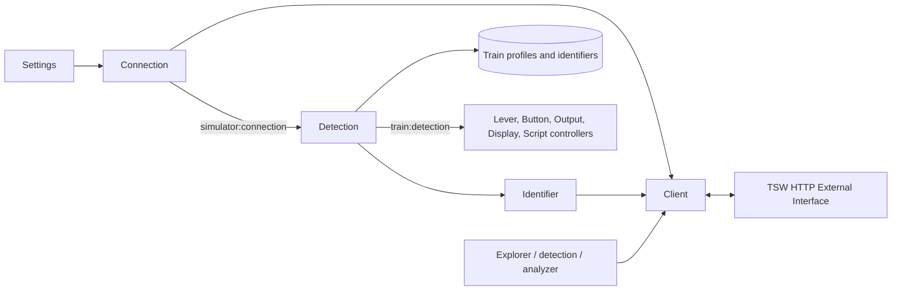

# Simulator integration and train detection

Baseline: `188f35e4108733358730e92ebd98f1912af5173a` (2026-10-25 review). This is a static implementation reference. Sources and test bodies were read; no game, hardware, network calls, or tests were executed for this document. An existing test describes intended evidence, not a claim that it passed during this review. UI workflows are documented separately in the UI reference.

## Boundaries and ownership

`Trenino.Simulator` delegates `windows?` to settings and `subscribe`, `get_status`, `retry_connection` to the connection GenServer. Settings owns URL and credentials; `Client` owns HTTP; `Connection` owns health/retry; `Train.Identifier` derives the vehicle identity; `Train.Detection` selects a saved profile; runtime train controllers consume `{:train_changed, train_or_nil}`. API discovery does not itself create a persisted profile or binding.

Sources: [facade](https://github.com/albertorestifo/trenino/blob/188f35e4108733358730e92ebd98f1912af5173a/lib/trenino/simulator.ex), [HTTP client](https://github.com/albertorestifo/trenino/blob/188f35e4108733358730e92ebd98f1912af5173a/lib/trenino/simulator/client.ex), [connection](https://github.com/albertorestifo/trenino/blob/188f35e4108733358730e92ebd98f1912af5173a/lib/trenino/simulator/connection.ex), [state](https://github.com/albertorestifo/trenino/blob/188f35e4108733358730e92ebd98f1912af5173a/lib/trenino/simulator/connection_state.ex), [identifier](https://github.com/albertorestifo/trenino/blob/188f35e4108733358730e92ebd98f1912af5173a/lib/trenino/train/identifier.ex), [detection](https://github.com/albertorestifo/trenino/blob/188f35e4108733358730e92ebd98f1912af5173a/lib/trenino/train/detection.ex).



## External interface contract

The local [TSW API guide](https://github.com/albertorestifo/trenino/blob/188f35e4108733358730e92ebd98f1912af5173a/docs/TSW_API_GUIDE.md) instructs the user to enable `-HTTPAPI`, launch the game, and obtain `CommAPIKey.txt`; it describes TSW 6/7 and default `http://127.0.0.1:31270`. These are repository instructions, not independently verified game capabilities. The implemented client accepts any binary `base_url` and `api_key`; it performs no URL/key validation or game version negotiation. Windows file-key discovery tries TSW7 before TSW6 under `%USERPROFILE%/Documents/My Games/<game>/Saved/Config/CommAPIKey.txt`, trims contents, and stops at the first readable file. A non-ENOENT file read error aborts instead of falling through. See [settings simulator helper](https://github.com/albertorestifo/trenino/blob/188f35e4108733358730e92ebd98f1912af5173a/lib/trenino/settings/simulator.ex) and the settings reference for credential precedence and persistence.

Every request uses `DTGCommKey: <api_key>`. Req normalizes header names internally. A client is `%Client{base_url, api_key, req}`. Normal request settings are `receive_timeout: 10000`, Finch `pool_timeout: 5000`, transient retries, `max_retries: 2`, and retry delay `100 * attempt` ms. `with_fast_timeouts/1` copies the client and uses a 1000 ms receive timeout, 500 ms pool timeout, retries disabled. Request latency therefore affects poll cadence; these are not hard real-time schedules.

| Elixir method | HTTP request | Parameters and result |
|---|---|---|
| `info(client)` | `GET /info` | Raw parsed response body |
| `list(client, nil)` | `GET /list` | Root discovery |
| `list(client, path)` | `GET /list/<encoded path>` | Node discovery |
| `get(client, path)` | `GET /get/<encoded path>` | Raw body, normally `Values` map |
| `set(client, path, value)` | `PATCH /set/<encoded path>` | Query `Value=value`; logs path and value |
| `subscribe(client,path,id)` | `POST /subscription/<encoded path>` | Query `Subscription=id`; explicitly supplies empty body for Content-Length |
| `get_subscription(client,id)` | `GET /subscription` | Query `Subscription=id` |
| `unsubscribe(client,id)` | `DELETE /subscription` | Query `Subscription=id` |
| `list_subscriptions(client)` | `GET /listsubscriptions` | Raw body |

Paths use `/` between nodes and `.` before endpoints/functions. Encoding preserves `/` and `.` and URI-encodes all other non-unreserved characters in each segment, so `Throttle(Lever)` becomes `Throttle%28Lever%29`. It does not remove an initial slash or normalize duplicate separators. Endpoint names and paths are case sensitive by transmission. Writes can use number, string, or boolean by documented type; implementation only guards the path, leaving value acceptance to Req/game.

Return contract is `{:ok, body}` for **HTTP 200 only**, `{:error, {:invalid_key, body}}` for 403, `{:error, {:http_error, status, body}}` for all other HTTP statuses, and `{:error, {:request_failed, reason}}` for transport failures. A 200 body containing `Result: Error` is still an `:ok` result: the client does not inspect game-level Result or Message. `:invalid_path` appears in its type declaration but is not separately produced. 201/204 are treated as errors. Credentials are captured in the client at construction rather than reread for each request.

Typed readers all call `get` and take **the first `Map.values(Values)` item**, requiring a nonempty Values map; they do not choose a named key or combine fields. `get_int` accepts integers, truncates floats, or accepts a completely parsed integer string. `get_float` accepts floats/integers or completely parsed float strings and rounds to two decimals. Neither accepts trailing units/text. `get_string` returns a binary as is or calls `to_string` on the first value. Missing/empty/unsupported typed values return `{:error, :invalid_value}` (unsupported string-conversion terms may raise through `to_string`). Raw `get` and subscription reads retain precision. Multi-value responses such as brake gauges therefore need an explicit field selection above this generic client; current controllers generally also pick their first value.

Normal subscription sample:

```json
{"RequestedSubscriptionID":1000,"Entries":[{"Path":"CurrentDrivableActor.Function.HUD_GetSpeed","NodeValid":true,"Values":{"Speed (ms)":5.97}}]}
```

The guide says speed is m/s and subscriptions are lost with the game session. No central subscription allocator exists: control detection uses **99**; output bindings allocate **1000 + endpoint index**; scripts **2000 + endpoint index**; displays **3000 + endpoint index**. Stated 1000-wide ranges are conventions without a hard upper bound. No client session namespace or collision arbitration protects multiple app instances or concurrent control-detection sessions. Endpoint iteration/map order is not a durable ID mapping.

Evidence: [client tests](https://github.com/albertorestifo/trenino/blob/188f35e4108733358730e92ebd98f1912af5173a/test/trenino/simulator/client_test.exs) check request methods, parameters, auth header, encoded parentheses, typed extraction, fast options, HTTP/transport mapping. They mock Req and are not tests against a live game. [facade test](https://github.com/albertorestifo/trenino/blob/188f35e4108733358730e92ebd98f1912af5173a/test/trenino/simulator_test.exs) only checks `windows?` returns a boolean.

## Connection state machine

Connection is a named GenServer. Public methods: `start_link`, `get_status`, `subscribe`, `retry_connection`, `reconfigure`, `disconnect`. When it is absent, `get_status` returns `ConnectionState.new()` (**needs_config**, despite a comment saying disconnected); retry/reconfigure/disconnect return `:ok` as no-ops. `subscribe` subscribes Phoenix PubSub topic `simulator:connection`; messages are `{:simulator_status_changed, %ConnectionState{...}}`.

State fields: `status` (`needs_config`, `connecting`, `connected`, `disconnected`, `error`), `client`, `last_error`, UTC `last_check`, API `info`, integer `health_failures` (0 initially).

| Transition | Exact behavior |
|---|---|
| Startup | Start needs_config, send `:connect` after configurable `connection_initial_delay_ms` (default 1000 ms) |
| Connect/retry | Ask `Settings.api_key`; error means needs_config, clearing client/error/check/info/failure count; no retry is newly scheduled on this branch |
| Credentials available | Create client, mark connecting, clear last_error; start `Task.Supervisor.async_nolink(Trenino.TaskSupervisor, Client.info)`; immediately broadcast connecting |
| Info succeeds | Store info/check timestamp, connected, clear errors/failures, schedule health in 30000 ms; broadcast connected |
| Info 403 | Error `invalid_key`, timestamp, reset health failures, schedule retry in 30000 ms; broadcast |
| Other info error / task DOWN | Error `connection_failed`, timestamp, reset health failures; retry after 30000 ms; broadcast |
| Manual disconnect | Clear client/check/info/failure count; status disconnected; broadcast; **last_error is retained** |
| Reconfigure | Mark disconnected and schedule connect in 500 ms; no immediate disconnected broadcast |

Healthy health checks use fast client `/info` every 30 seconds. Success refreshes info/check, clears health failures and resumes normal interval **without broadcasting**. Transient failures 1 and 2 preserve connected status and client, set last_error to `connection_failed`, timestamp and increment failures; schedule another check in 2000 ms and do not broadcast. Third consecutive failure becomes error and resets the counter to zero through `mark_error`, broadcasts and schedules retry. Invalid key is immediately permanent: error/broadcast/retry without tolerance. Health check with no client yields `no_client`. Health messages received outside connected status skip I/O but still schedule another 30-second health check.

Implementation caveats for a rewrite: connect tasks are not recorded with a generation/token. Any reference-shaped task response can update current state, so a late result can overwrite a disconnect/reconfiguration/new attempt; overlapping manual retries are possible. Timer references are not retained or canceled. Disconnect is therefore not a persistent inhibition of already scheduled retries/connects, and repeated reconnect events may accumulate health/detection polling messages. Initial connect can take normal retry/timeout durations. `mark_connecting` retains previous info/check/failure count; `mark_error` retains the client/info; consumers must gate on status, not client presence alone.

Evidence: [state tests](https://github.com/albertorestifo/trenino/blob/188f35e4108733358730e92ebd98f1912af5173a/test/trenino/simulator/connection_state_test.exs) cover field transitions and resets; [connection tests](https://github.com/albertorestifo/trenino/blob/188f35e4108733358730e92ebd98f1912af5173a/test/trenino/simulator/connection_test.exs) simulate initial success, single tolerated failure, three failures, permanent auth failure, and recovery by mocking Req and sending health messages. The tests do not cover all overlapping-task/timer cases above.

## Automatic profile selection

### Identifier derivation and matching

`Identifier.derive_from_formation(client)` reads `CurrentFormation.DrivableIndex` with `get_int`, then `CurrentFormation/<index>.ObjectClass` with `get_string`. If **either** operation fails, it falls back to `CurrentFormation/0.ObjectClass`. It removes an exact terminal `_C`, then strips trailing characters outside ASCII letters/digits. It does not query `ProviderName`, inspect all wagons, or call the common-prefix helper in this flow. An empty normalized identifier is not rejected here.

`common_prefix(list)` is a separate utility: empty -> `""`, singleton -> unchanged, otherwise common grapheme prefix with trailing nonalphanumeric stripping. `extract_train_name` is a display heuristic: remove optional `_C` and `RVM`, skip the first remaining route segment, prefer adjacent `DB` + `BR<number>`, then known company + model, then `Class<number>`, then one-letter model (`M9`, optional `-B`), then 2–10 alphanumeric mixed letter/digit token. Unknown formats return empty string. Known companies: BNSF, UP, NS, CSX, DB, SNCF, LIRR, MBTA, NJT, AMTK. These names are suggestions, not identity keys.

`Train.get_train_by_identifier(detected)` loads every train and identifiers, selects profiles where **any** stored identifier is a `String.starts_with?` prefix of detected. Identifiers are equivalent peers; no primary, ordering priority, exact-match priority, or longest-prefix tie-break exists. Comparison is case sensitive and not delimiter-aware. Two matching identifiers on one profile produce one result; different matching profiles yield `{:error, {:multiple_matches, trains}}`. No match yields `{:error, :not_found}`. Exactly one returns a train with identifiers and `elements: :lever_config` preloaded (controllers obtain their fuller binding data separately).

Evidence: [identifier tests](https://github.com/albertorestifo/trenino/blob/188f35e4108733358730e92ebd98f1912af5173a/test/trenino/train/identifier_test.exs), [prefix matching tests](https://github.com/albertorestifo/trenino/blob/188f35e4108733358730e92ebd98f1912af5173a/test/trenino/train/train_identifier_matching_test.exs), [persistence tests](https://github.com/albertorestifo/trenino/blob/188f35e4108733358730e92ebd98f1912af5173a/test/trenino/train/train_identifier_persistence_test.exs), [blank identifier tests](https://github.com/albertorestifo/trenino/blob/188f35e4108733358730e92ebd98f1912af5173a/test/trenino/train/train_identifier_test.exs). They cover nonzero drivable index, fallback, normalization, case sensitivity, equivalent unrelated prefixes and ambiguity.

### Detection lifecycle, events, and grace

Detection subscribes to simulator connection on init, queues `:check_connection`, and keeps active_train, current_identifier, last_check, polling_enabled, detection_error, last_successful_contact (monotonic milliseconds), last_client, grace_client and grace_timer. Public API: `get_active_train`, `get_current_identifier`, `get_state`, `sync`, `subscribe`; unlike Connection the getters require the process to exist. Topic is `train:detection`.

On init with an already connected simulator it schedules a first poll **in 5000 ms**. On connected broadcast it exits grace, enables polling, schedules a poll in 5000 ms **and queues one immediately**. Each enabled poll obtains current connected client, remembers it, derives identity and schedules the next poll in 5000 ms after the operation. A poll while disabled does nothing. `sync` clears current_identifier to force a new database lookup, using grace_client if in grace or the current connected client otherwise.

| Detection outcome | State and published events |
|---|---|
| Identifier unchanged | Update last_check and last_successful_contact; no database lookup or profile event |
| New identifier, exactly one match | `{:train_detected, %{identifier: value, train: train}}`; `{:train_changed, train}` only if active struct differs; set active/current, clear error, timestamp |
| New identifier, no match | train_detected with nil; train_changed nil only if a train was previously active; store identifier with no active train |
| New identifier, ambiguous | train_detected with nil; `{:multiple_trains_match, %{identifier: value, trains: matches}}`; train_changed nil if previously active; store `{:multiple_matches, matches}` |
| Identifier read failure | `{:detection_error, reason}`; retain prior active train, identifier and last_check |

Consequently editing/creating a matching profile while the detected identifier stays the same needs `sync` (and controller reloads as appropriate); normal polling alone does not requery profiles. A successful identity read counts as contact even if no profile matches.

On any nonconnected status: disable normal polling. With no active train, clear identity/error/contact and broadcast `train_changed nil`. With active train and remembered client, enter grace by constructing fast client, retain train, and poll every **200 ms**. Default grace expiration is **30000 ms since last successful identity contact** (`detection_grace_period_ms` can override). Grace polls that succeed refresh contact and continue; they **ignore the returned identity** and do not select a new profile. They can keep the prior profile active indefinitely while the global connection state is error. Failures past the threshold exit grace and deactivate. Before threshold they reschedule. No last_client causes immediate deactivation. Repeated disconnects while already in grace do not reenter/reset it. Reconnect clears grace and resumes immediate normal detection. `grace_timer` exists but `schedule_grace_poll` does not assign it; late grace messages are safely ignored once grace_client is nil.

The grace policy preserves bindings in memory, but ordinary controllers still check global simulator connected status for HTTP I/O. It does not authorize writes through the grace client; only Detection uses that client. Identity read errors while the global connection remains connected do **not** start grace or deactivate by themselves.

Evidence: [detection tests](https://github.com/albertorestifo/trenino/blob/188f35e4108733358730e92ebd98f1912af5173a/test/trenino/train/detection_test.exs) cover API state, enabling/disabling polling, matching, retaining active profile during grace, success prolongation, expiration with shorter test configuration, clean recovery, repeated disconnects and sync during grace. Most use injected state/mocked Identifier rather than a live simulator.

## Control discovery: two different implementations

### Name-based suggestions (`ControlDetector`)

`suggest_lever(name)` / `suggest_button(name)` require connected client, list `CurrentDrivableActor`, and expect `Nodes` to be a **list of strings**. Each binary control is listed individually; its returned `Nodes` must again contain endpoint **strings**. Lever classification checks substring `Function.GetNotchCount`; button classification checks `Property.bDefaultToPressed`. Nonbinary nodes, malformed structures, or per-control list errors are skipped. Top-level malformed success becomes empty controls; a top-level request error propagates. Suggested lever endpoint paths are constructed rather than individually verified: min/max InputValue functions, `.InputValue`, notch-count/index functions. Button suggestion constructs `.InputValue`.

Scoring downcases both names: exact 1.0; element contained in control .85; control contained in element .75; otherwise split on whitespace/underscore/hyphen/parentheses, count common element words, compute base `min(.5 + .2 * count, .9)` and average with Jaro distance; if no common words use Jaro alone. Best candidate is accepted only at **strictly > .3**. Although a helper contains camelCase splitting, strings are lowercased before it runs, so that branch cannot split original capitals. No alias dictionary maps “Power” to “Throttle”; no cache or learned preference exists. O(n) serial list calls are made for each suggestion. Returns suggestion map with control_name/confidence and relevant endpoints, or not_connected/no_match/request error. A request timeout is not automatically remapped to not_connected despite the old guide's wording.

### Interaction-based discovery (`ControlDetectionSession`)

`start(client,callback_pid)` starts an unlinked GenServer that **monitors** callback. In contrast with name suggestions, recursive discovery expects `Nodes` to be **maps** with `NodeName` or `Name`, and `Endpoints` to be maps with `Name == InputValue` and `Writable == true`. It descends child nodes and skips failed child lists. It does not collect writable InputValue directly from the root response. It deletes subscription 99, subscribes discovered endpoints into that group, accepts partial success if at least one subscribe succeeded, then takes a baseline from `Entries` maps with numeric first Values item.

It polls every **150 ms**, compares current numeric values against the initial baseline, and detects **absolute difference strictly > .01**. New paths without baseline, nonnumeric values, malformed success and small differences are ignored. NodeValid is not checked. The first poll with changes sends `{:control_detected, [%{endpoint, control_name, previous_value, current_value}, ...]}` and terminates; simultaneous changes are returned together. control_name removes CurrentDrivableActor/InputValue and takes the final node. No changes for **30000 ms after setup** sends `{:detection_timeout}` and stops. Poll failures are logged and polling continues; setup failure sends `{:detection_error, reason}` and init stops with normal reason (`start` returns error normal). Explicit stop, callback DOWN, timeout and success cancel stored timers and unsubscribe 99 in terminate.

Caveats: the two discovery implementations accept incompatible list response shapes; a rewrite must test actual game responses rather than assume both work with one representation. Concurrent detection sessions overwrite/delete shared group 99. Setup is synchronous and timeout starts only after discovery/subscriptions/snapshot. Failed init after subscriptions lacks a fully initialized state/terminate cleanup path. See [session source](https://github.com/albertorestifo/trenino/blob/188f35e4108733358730e92ebd98f1912af5173a/lib/trenino/simulator/control_detection_session.ex), [session tests](https://github.com/albertorestifo/trenino/blob/188f35e4108733358730e92ebd98f1912af5173a/test/trenino/simulator/control_detection_session_test.exs), and [suggestion source](https://github.com/albertorestifo/trenino/blob/188f35e4108733358730e92ebd98f1912af5173a/lib/trenino/simulator/control_detector.ex). The old [suggestion guide](https://github.com/albertorestifo/trenino/blob/188f35e4108733358730e92ebd98f1912af5173a/docs/control_auto_suggestion.md) refers to `control_detector_test.exs`, which is absent from the assigned/current test manifest; do not count that guide as test evidence.

## Empirical lever analysis (`LeverAnalyzer`)

Analysis actively **writes the simulator control**, unlike read-only discovery. `analyze(client, control_path, opts)` queries min/max InputValue functions, using returned range if min < max or fallback 0..1 otherwise. Defaults: sweep step .02, settling time 150 ms; optional restore_position (default nil). It pushes minimum five times with 30 ms delays, then waits settling time, generates `round(range / step) + 1` two-decimal setpoints filtered <= max. A range not divisible by step need not include exact maximum. For each point: set `.InputValue`, sleep settling, read actual `.InputValue`, `.Function.GetCurrentOutputValue`, and `.Function.GetCurrentNotchIndex` (float reader then round). Sample records set_input, actual_input, output, notch_index, snapped (`abs(actual-set) > .03`). Failures skip the point; fewer than ten successful samples -> insufficient_samples. Restore occurs only after successful sweep+analysis, and restoration failure is ignored. There is no rollback of game state on errors or cancellation in this pure function.

`analyze_samples` expects a nonempty sample list; empty input reaches Enum.min/Enum.max and raises. Group by notch index, sort groups by minimum set_input. Adjacent groups merge unless first actual input of next group differs from current zone's **maximum actual_input by > .03**. A zone stores output extrema, set/actual input extrema and merged notch_indices. Gate/linear decision compares output extrema rounded to **one decimal**: difference < .15 -> gate, else linear. Gate value is mean output extrema rounded to two decimals. Snapped flags are retained in samples but the merging decision uses actual-input boundary differences directly.

Classification priority: all outputs within .05 of integers, <=15 unique outputs and no linear zone -> discrete; >=20 unique with no gate -> continuous; mixed gate+linear -> hybrid; >=20 otherwise -> continuous; else discrete. Suggested notches are sorted by set_input minimum and given sequential indices. Gate suggestion includes type/index/value/input_min/input_max/actual_input_min/actual_input_max/description; linear substitutes min_value/max_value for value. **Suggestion input ranges are simulator setpoint ranges**, and Train context copies them to `sim_input_min/max`; hardware ranges remain unset until mapping. Output values are descriptive and cannot replace simulator input ranges.

`quick_check` samples setpoints 0,.25,.5,.75,1 regardless of reported range, waits 100 ms by default (`delay_ms` override), reads current output, and returns sample_failed on any error; integer-like <=5 unique -> discrete, fractional -> continuous, otherwise unknown. It does not restore the lever; because only five points are taken the integer unique-count branch almost always classifies discrete.

Evidence: [analyzer source](https://github.com/albertorestifo/trenino/blob/188f35e4108733358730e92ebd98f1912af5173a/lib/trenino/simulator/lever_analyzer.ex), [pure sample-analysis tests](https://github.com/albertorestifo/trenino/blob/188f35e4108733358730e92ebd98f1912af5173a/test/trenino/simulator/lever_analyzer/analysis_test.exs), [mocked HTTP integration tests](https://github.com/albertorestifo/trenino/blob/188f35e4108733358730e92ebd98f1912af5173a/test/trenino/simulator/lever_analyzer_test.exs). Covered examples include discrete/continuous/hybrid, merging without snaps, isolated gates and negative -1..1 setpoint ranges. “Integration” here uses mocked HTTP, not actual game behavior.

## Reference discrepancies to preserve as decisions

| Existing prose claim | Current implementation |
|---|---|
| Train guide: detection every 15 seconds, CurrentDrivableActor then ProviderName | 5-second polling; formation DrivableIndex/ObjectClass then formation index 0 |
| Identifier moduledoc: common formation prefix | Utility exists, but active derivation uses driven vehicle |
| Train guide: manual Set Active | No active-profile setter in reviewed Train/Detection API; UI reference should establish any UI affordance rather than infer it |
| TSW guide: all InputValue ranges 0..1 and index/(count-1) | Analyzer and persisted sim ranges support negative/nonstandard ranges; current mapping uses empirical ranges |
| Auto-suggestion guide: camelCase/common-word matching and generic timeout mapping | Downcasing precedes camel splitter; request errors propagate; response shapes may disagree |
| Guide: group subscriptions/recreate at game startup | Client supports grouping; output/script controllers allocate per endpoint and do not universally rebuild on reconnect |

See [train profiles and controls](train-profiles-and-controls.md) for domain contracts, calibration and runtime differences, [scripting and sequences](scripting-and-sequences.md) for scheduling and external actions, and [stories](train-user-stories.md) for acceptance/failure cases.
