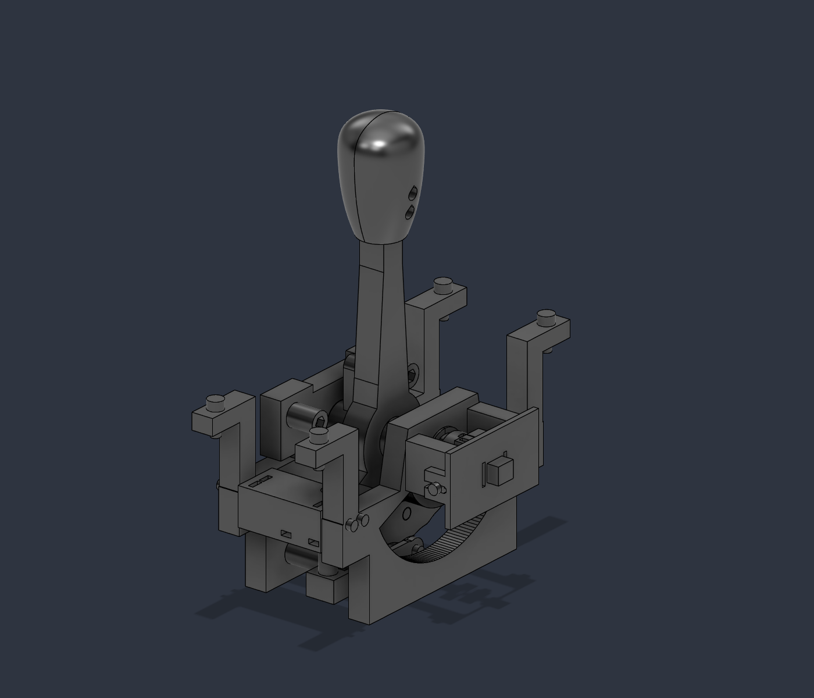
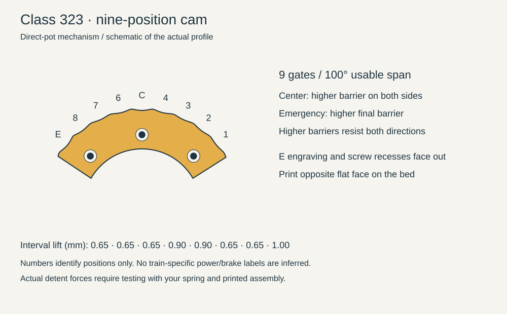

# Direct-pot upgrade: one-piece shaft and Class 323 cam

This revision updates the direct-drive design you built. It uses a one-piece shaft and retains the floating direct-pot coupling and 104-degree mechanical travel, with its pivot lowered 35 mm to match the geared design's Z30 height. Rail mounting seats remain unchanged. The top panel is outside this revision.

## Required replacements

| Part | Prints | Reason |
|---|---:|---|
| P01 left plate | 1 | Recessed mounting towers and support-free stepped stop counterbores |
| P02 right plate | 1 | Recessed towers, shorter pot supports and captive carriage nuts |
| P04 right bush | 2 halves | Fits radially around the existing shaft; no need to force it over the shoulder |
| P13 spring reaction block | 1 | Bottom preload reaction nut, accessible guide/mount nuts, stepped pocket bridges |
| P19 sensor clamp | 1 | Accessible captive nut replaces the insert; coupling faces retained |

Those corrections require six prints. Add the new one-piece P05 shaft and P08 nine-notch cam: eight prints total from your original v6. If you already printed the prior correction package, only P05 and the new P08 are new. The supplied required-stl folder contains all eight.

 Use the supplied orientations: both P04 halves stand on their flange faces, with the journal bore vertical. Existing P16 mount and P18 floating disc are reused: move P16 inward 3.2 mm, fully against the shortened support ends. The shorter support positions the measured 8 mm moving pot shaft for 7.7 mm nominal engagement, leaving 0.3 mm between the hub and stationary M7 bushing. Confirm these gaps physically and allow the floating disc to slide freely.

## Optional replacements

The optional folder contains the P07 rotor with captive nuts and the P09 grip half with tighter 3.8 mm insert bores and 0.2 mm lead-in chamfers. Reuse your existing rotor and grip when their inserts hold securely. The new P05 shaft is supplied as one solid print; retire both old shaft halves, both P28 alignment keys, and their two joining screws and nuts.

The P09 insert dimensions are a fit trial responding to insufficient melt engagement, not a measured printer correction. Test a small pocket coupon in the same material before committing to the grip. P09 retains inserts because a nut behind its socket with the existing screws would leave a thin loaded wall.

## Hardware changes

Required replacements use ten additional standard M3 hex nuts: two carriage, four crossblock mounts, two guide screws, one preload and one sensor clamp. The new shaft adds one cap nut. The optional rotor adds four more: cam 3 and rotor clamp 1. That is eleven additional nuts with the required prints, or fifteen including the optional rotor. The new cam reuses the existing three cam screws. Reuse the existing screw lengths, bearings, spring, pot, M5 rail screws and T-nuts. Nominal nut model 5.5 mm across flats x 2.4 mm thick; check actual stock. Maker Inventory records 160 M3 nuts in the existing kit, but current remaining count is estimated and the build has not been checked out.

## Assembly changes

1. Back off preload and restrain/remove the spring before disassembly. Keep the unchanged printed parts and hardware labeled.
2. Install P13 mount nuts from the top, guide nuts through the rear slots, and preload nut from the bottom. The preload nut bears on its upper pocket shoulder; guide nuts bear on their lower shoulders. Do not reverse these load paths.
3. Print P05 on its continuous underside flat. Before the left housing covers the shaft end, turn that flat upward and insert the cap nut through its open slot. Keep it upward while sliding the housing/bush into place; their bore captures the nut. No shaft-joining screws or alignment keys are used.

4. Strip the shaft of its cap, rotor and thrust spacers first. Slide empty P02 onto the shaft from the LEFT end, across the central D section; hold it 40 mm left of its final position so its sensor arms end before the right journal. Place both P04 halves radially on the right journal, then slide P02 RIGHT onto their cylindrical bodies until its outer face meets their flange. Fit the right thrust spacer, rotor, left spacer, preassembled P03-in-P01 pair and retaining cap from the left. The bush flange prevents approaching it with P02 from the right; follow this order. Do not enlarge the running bore to pass the shoulder.
5. Secure P13 and complete the retained follower/cup/guide assembly. Nut pockets must contain their nuts before access is closed. Check the guide cup slides freely and the preload screw actually bears on the cup.
6. Fit the two P02 carriage nuts from the shortened support ends before installing P16. Refit P16 inward 3.2 mm; align its existing slots with the new carriage bolt centers. Install P19's nut from the top before mounting the clamp. Center the pot electrically/mechanically before tightening its shaft clamp.
7. Mount on the original top rails. Check the lowered mechanism and wiring clear the frame. Turn through the full travel gently and verify stops act before the pot's own limits.

Optional P07 cam nuts load from the rotor's rear. They resist rotation but can slide out axially when screws are removed; retain them with a finger during cam changes. The rotor clamp nut loads from its side pocket before assembly.

## Print and commissioning notes

The stepped counterbore/nut-pocket reliefs are intentional bridge geometry. Do not add support automatically or remove the small steps from CAD. Default printer/material/process profiles remain unchanged; inspect the slicer preview and clear only any sag or burr that impedes screw seating.

Check actual spring solid height, free guide motion, nut retention, low-force lever travel, pot clearance and reversal play. The narrow wall beside P13's outer guide nut is a lightly loaded guide restraint; avoid overtightening. Digital checks do not establish strength or a torque rating.

Final validation results and exact file lists are provided separately. No printer-ready G-code is supplied while the existing CLI reports invalid tool configuration.

## Class 323 nine-notch disc

Nine stable positions span -50 to +50 degrees in 12.5-degree steps. Position 5 is center. Position 9, marked E, is Emergency. Positive travel moves the handle toward negative Y, toward the spring-block side in this assembly. Fit the disc with its recessed screw heads and engraved E facing outward. This is the requested tactile arrangement, not a verified reproduction of the original train's controller.

Ordinary interval lift is 0.65 mm; both intervals adjoining center use 0.90 mm; the final interval before Emergency uses 1.00 mm. These are follower displacements, not measured hand forces. The passive barriers resist both directions: Emergency also takes more effort to leave, and center takes more effort to approach. No one-way lockout is included. Peak lift is below the old 1.4 mm cam. Exact feel depends on the spring, preload, friction and print finish.

Reuse the existing three cam screws. To change the disc, unload and restrain the spring (remove it if backing off preload does not fully unload it), remove the sensor carriage and floating coupling, clear the follower, then withdraw the cam toward the sensor side. Retain any loose cam nuts during removal. Recenter the pot afterward and check both mechanical stops before applying force.

## One-piece shaft limits

The original upper D drive face is retained. A continuous opposite flat gives a horizontal bed face without generated supports. The journal loses 9.4% of its cross-sectional area, and its ideal geometric movement toward the flat increases by about 0.062 mm relative to the original round journal; neither figure is a strength rating. The tongue extends to positive Y=8 mm to retain its maximum contact arm, but its contact is asymmetric. Check bushing drag, reversal play and tongue wear after initial use. The split P04 bush remains necessary around the integral shoulder.
